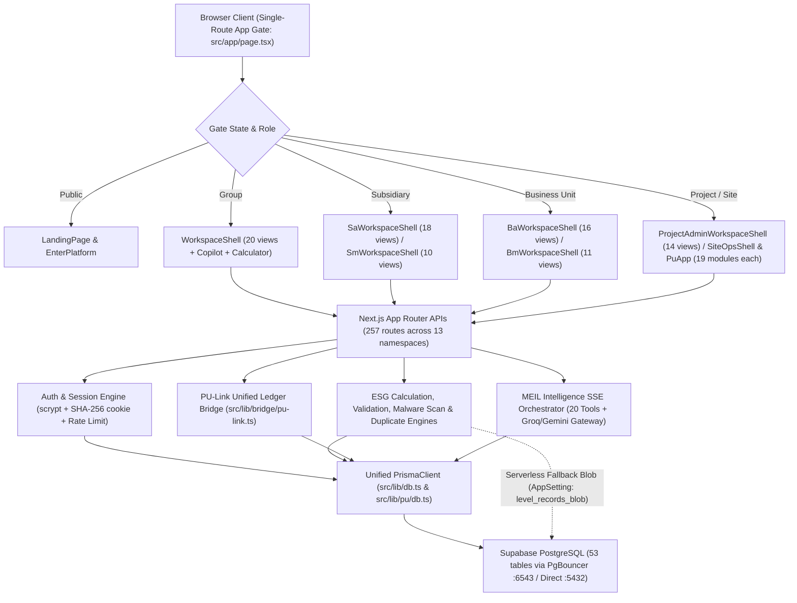

# MEIL ESG & BRSR Reporting Platform — Complete Technical Reference (`everything.md`)

> Comprehensive, code-verified blueprint of `d:\MEIL-PROJECT` covering folder structure, tech stack, frontend architecture, backend APIs & engines, database topology, all 53 Prisma models/tables, concrete Prisma & SQL queries, engineering Q&A, and prioritized next steps.

---

## Table of Contents

1. [System Overview](#1-system-overview)
2. [Folder Structure](#2-folder-structure)
3. [Tech Stack & Build Configuration](#3-tech-stack--build-configuration)
4. [Frontend Architecture](#4-frontend-architecture)
5. [Backend Architecture (257 API Routes & Engines)](#5-backend-architecture-257-api-routes--engines)
6. [Database Topology & Persistence History](#6-database-topology--persistence-history)
7. [Complete Prisma Schema & Tables (53 Models)](#7-complete-prisma-schema--tables-53-models)
8. [Queries With Details (Prisma & SQL)](#8-queries-with-details-prisma--sql)
9. [Possible Questions & Answers](#9-possible-questions--answers)
10. [Next Suggestions & Engineering Roadmap](#10-next-suggestions--engineering-roadmap)

---

## 1. System Overview

The **MEIL ESG & BRSR Reporting Platform** is a multi-tier enterprise Sustainability, Carbon Accounting, and SEBI **BRSR** (Business Responsibility & Sustainability Reporting) management system modeled around a four-level corporate hierarchy:

- **Group Level** (`GROUP_ADMIN`, `ORG_MANAGER`) — enterprise consolidation, Group BRSR drafting/finalization, subsidiary oversight, MEIL Intelligence AI Copilot.
- **Subsidiary Level** (`SUBSIDIARY_ADMIN`, `SUBSIDIARY_MANAGER`) — 7 subsidiaries, timelines, BRSR subsidiary templates, validation & first-tier/subsidiary review queues.
- **Business Unit Level** (`BU_ADMIN`, `BU_MANAGER`) — 16 business units, package assembly, validation rules, BU rollup & queue approvals.
- **Project & Site Operations Level** (`PROJECT_ADMIN`, `SITE_OPS`, and 8 `PROJECT_USER_ROLES`) — 9-level ESG data capture (Energy, Water, GHG, Waste, Safety, Training, Compliance, Incidents, Initiatives), OCR & evidence upload security scanning, deterministic calculation & validation engines, and project consolidation.



---

## 2. Folder Structure

### 2.1 Root Workspace Layout (`d:\MEIL-PROJECT`)

| Path | Purpose |
|---|---|
| `src/` | Next.js application source (`app/`, `components/`, `lib/`, `hooks/`) |
| `prisma/` | Unified PostgreSQL schema (`schema.prisma`), historical schema variants, seed scripts, JSON hybrid stores |
| `db/` | Legacy local SQLite snapshots (`custom.db` — 839,680 bytes / 47 tables; `pu.db` — 450,560 bytes / 38 tables) |
| `docs/` | Architecture docs (`MEIL-INTELLIGENCE.md`, `SUPABASE-MIGRATION.md`) |
| `public/` | Static brand assets (`logo.svg`, `meil-logo.jpg`, project JPGs, `robots.txt`) & `public/evidence-uploads/` |
| `scripts/` | Seeders, E2E verification scripts (`.mjs`, `.mts`, `.ts`, `.sh`), standalone build helper, PDF doc generators (`.py`) |
| `tests/` | Unit & shell integration tests (`tests/calculator/`, `tests/copilot/`, runtime `.sh` tests) |
| `package.json` | Dependencies, Next/Prisma scripts |
| `next.config.ts` | Next.js build flags (`typescript.ignoreBuildErrors: true`, `reactStrictMode: false`) |
| `tsconfig.json` | TypeScript strict config + `@/* -> ./src/*` path alias (`examples`, `tests`, `prisma/seed-pu.ts` excluded) |
| `components.json` | shadcn/ui CLI config (`new-york` style, RSC enabled, Lucide icons, `@loading-ui` registry) |
| `tailwind.config.ts` / `postcss.config.mjs` / `eslint.config.mjs` | Styling and linting configuration |
| `Caddyfile` | Reverse proxy config for standalone/container deployments |
| `HACKATHON_BRSR_GUIDE.md` / `README.md` / `worklog.md` / `tasks-todo.md` / `AGENTS.md` | Project documentation, worklogs, agent rules |
| `meil_esg_database_dump.sql` | SQL database dump artifact at repo root |

### 2.2 Detailed `src/` Tree

```text
src/
├── app/
│   ├── globals.css
│   ├── layout.tsx                        # Fonts + Copilot CSS + Sonner <Toaster />
│   ├── page.tsx                          # Single-route App Gate (dynamic portal switcher)
│   ├── enter/page.tsx                    # Redirects to /?enter=1
│   ├── evidence-uploads/[...path]/route.ts # Authenticated/static file serving for uploaded evidence
│   └── api/                              # 257 API route handlers across 13 namespaces
│       ├── route.ts                      # Root API metadata/index
│       ├── auth/          (5 routes)     # login, logout, session, lookup-role, forgot-password
│       ├── esg/           (16 routes)    # Group admin APIs (dashboard, brsr, brsr-checklist, consolidation, etc.)
│       ├── sa/            (31 routes)    # Subsidiary Admin APIs
│       ├── sm/            (16 routes)    # Subsidiary Manager APIs
│       ├── ba/            (31 routes)    # Business Unit Admin APIs
│       ├── bm/            (19 routes)    # Business Unit Manager APIs
│       ├── project-admin/ (15 routes)    # Project Admin APIs
│       ├── pu/            (58 routes)    # Project User Portal APIs
│       ├── so/            (53 routes)    # Site Operations APIs
│       ├── copilot/       (7 routes)     # chat (SSE), confirm, conversations, [id], explorer, saved, suggestions
│       ├── master/        (3 routes)     # subsidiaries, business-units, projects
│       ├── health/        (1 route)      # db/route.ts
│       └── revision/      (1 route)      # Cross-console live revision fingerprint polling
│
├── components/                           # 13 directories (314 files total)
│   ├── workspace/       (25 files)       # Group Admin shell + 20 views
│   ├── subsidiary/      (20 files)       # Subsidiary Admin shell + 18 views
│   ├── manager/         (15 files)       # Subsidiary Manager shell + 10 views
│   ├── ba/              (19 files)       # Business Unit Admin shell + 16 views
│   ├── bm/              (17 files)       # Business Unit Manager shell + 11 views
│   ├── project-admin/   (18 files)       # Project Admin shell + 14 views
│   ├── pu/              (33 files)       # Project User shell + 19 domain modules
│   ├── site-ops/        (32 files)       # Site Ops shell + 19 domain modules
│   ├── copilot/         (7 files)        # workspace, floating, explorer, blocks, copilot.css, avatar/engine.ts, avatar/meil-avatar.tsx
│   ├── landing/         (2 files)        # landing-page.tsx, landing.css
│   ├── enter-platform/  (2 files)        # enter-platform.tsx, enter-platform.css
│   ├── shared/          (31 files)       # Calculator (5), Data Entry L1-L9 (16), Evidence security, Review window, Modals, CSV import
│   └── ui/              (53 files)       # shadcn/ui primitives + border-beam.tsx + chat.tsx + input-group.tsx + chat-utils/*
│
├── hooks/
│   ├── use-mobile.ts
│   └── use-toast.ts
│
└── lib/                                  # Domain logic, DB clients, role helpers, stores, AI & calculators
    ├── db.ts                             # Global hot-reload-safe PrismaClient + checkDatabaseHealth()
    ├── platform-config.ts                # 15 ROLES, 4 PORTAL_ROLES, DASHBOARD_PATHS, cookie TTL constants
    ├── session.ts                        # Token minting, SHA-256 tokenHash, sessionPayloadCache
    ├── password.ts                       # OWASP scrypt hashing, timingSafeEqual, demo password handling
    ├── rate-limit.ts                     # In-memory login attempt throttling (5 failures / 15 min)
    ├── auth-audit.ts / uploads.ts / utils.ts / portal-cache.ts / revision-client.ts
    ├── ai/gemini.ts                      # Direct Gemini REST helper
    ├── brsr/sections.ts                  # BRSR section definitions & completeness counters
    ├── bridge/pu-link.ts                 # PU <-> Main hierarchy scope & decision reflection bridge
    ├── calculator/                       # engine.ts (parser), carbon.ts, travel.ts, store.ts
    ├── copilot/                          # orchestrator.ts, gateway.ts, tools.ts, offline.ts, actions.ts, server.ts, client.ts, store.ts, talk.ts, types.ts
    ├── evidence/                         # security.ts (5-layer scan), duplicates.ts (SHA-256 match), upload-client.ts
    ├── esg/ | sa/ | sm/ | ba/ | bm/ | project-admin/   # Console-specific client/server/store/rows/types modules
    ├── pu/                               # db.ts (alias to mainDb), engines.ts, validators.ts, workflow.ts, scope.ts, level-records.ts, brsr-resolver.ts, brsr-pdf-generator.ts, submission-report-pdf.ts, etc.
    └── so/                               # Site Ops mirror of calculation, validation, BRSR, workflow, finance/contributor stores
```

### 2.3 Supporting Directories (`prisma/`, `docs/`, `scripts/`, `tests/`, `db/`)

- **`prisma/`**: `schema.prisma` (active), `schema.postgres.prisma`, `schema.sqlite.prisma`, `pu-schema.prisma`, `pu-schema.postgres.prisma`, `POSTGRES-MIGRATION.md`, `seed.ts`, `seed-auth.ts`, `seed-sa.ts`, `seed-bu.ts`, `seed-pa.ts`, `seed-pu.ts`, `seed-so.ts`, `clean-alias-junk.ts`, `fix-dossier-evidence.ts`, `reset-transactional-data.ts`, `level-records-store.json`, `pa-preferences-store.json`.
- **`scripts/`**: `api-e2e.mjs`, `copilot-smoke.mjs`, `verify-copilot-db.mjs`, `e2e-all-roles.mts`, `e2e-all-roles-submissions.mts`, `e2e-escalation-flow.mts`, `e2e-verify-pa.mts`, `e2e-pu-link.sh`, `backfill-so-mirror-scope.mts`, `mint-session.mjs`, `revoke-session.mjs`, `export-sql-dump.ts`, `reset-and-reseed.ts`, `seed-brsr-data.ts`, `seed-brsr-report.ts`, `seed-hackathon-flow.ts`, `test-db.ts`, `copy-standalone.mjs`, `generate_dashboard_pdf.py`, `generate_technical_architecture_pdf.py`.
- **`tests/`**: `tests/calculator/calculator.test.ts`, `tests/copilot/{avatar-engine,backend,gateway-sse,groq-provider,provider-protocol}.test.ts`, `tests/database-runtime-build.sh`, `tests/python-runtime-build.sh`, `tests/python-runtime-container.sh`.

---

## 3. Tech Stack & Build Configuration

### 3.1 Core Stack (Verified from `package.json`)

| Layer | Package / Technology | Version | Role |
|---|---|---|---|
| **Framework** | `next` | `16.1.3` | App Router (`src/app`), dynamic portals, Route Handlers (`src/app/api/**`) |
| **UI Runtime** | `react`, `react-dom` | `^19.0.0` | React 19 client & server rendering |
| **Language** | `typescript` | `^5` | Strict mode enabled in `tsconfig.json` |
| **Styling** | `tailwindcss`, `@tailwindcss/postcss`, `tw-animate-css` | `^4` / `^1.3.5` | Tailwind CSS v4 + custom Liquid Glass CSS (`copilot.css`, `calculator.css`, `globals.css`) |
| **Component Kit** | `shadcn` (`new-york`), `@radix-ui/*` | Multiple primitives | 53 accessible UI primitives under `src/components/ui/` |
| **Icons** | `lucide-react` | `^0.525.0` | Standard UI icon library |
| **Animation** | `framer-motion` | `^12.23.2` | `BorderBeam`, transitions, floating copilot & calculator dock motion |
| **State & Query** | `zustand`, `@tanstack/react-query` | `^5.0.6`, `^5.82.0` | Copilot/Calculator/Console client stores + async query caching |
| **Tables & Forms** | `@tanstack/react-table`, `react-hook-form`, `@hookform/resolvers`, `zod` | `^8.21.3`, `^7.60.0`, `^5.1.1`, `^4.0.2` | Structured data grids & schema-validated forms |
| **Charts** | `recharts` | `^2.15.4` | ESG, BRSR, Subsidiary & BU analytics charts |
| **ORM & Database** | `prisma`, `@prisma/client`, `pg` | `^6.11.1` (runtime `6.19.3`), `^8.23.1` | Unified PostgreSQL (Supabase) ORM access |
| **Auth & Utilities** | `next-auth`, `next-themes`, `next-intl`, `cmdk`, `sonner`, `debounce`, `react-use-measure` | `^4.24.11`, `^0.4.6`, `^4.3.4`, `^1.1.1`, `^2.0.6`, `^2.2.0`, `^2.1.1` | Custom cookie sessions (`meil_esg_session`), theme toggles, command palette, chat scroll autosizing |
| **Rich Text & Docs** | `@mdxeditor/editor`, `react-markdown`, `jspdf`, `jspdf-autotable`, `pdfjs-dist` | `^3.39.1`, `^10.1.0`, `^4.2.1`, `^5.0.9`, `^6.5.438` | BRSR report generation, PDF exports, client/server OCR text parsing |
| **Drag & Drop / Media** | `@dnd-kit/*`, `sharp` | `^6.3.1`+, `^0.34.3` | Hierarchy / board interactions, image processing |
| **AI & Agents** | `z-ai-web-dev-sdk` + custom Groq/Gemini fetch gateway | `^0.0.18` | MEIL Intelligence Copilot & Gemini OCR/AI helpers |
| **E2E / Testing** | `playwright`, `tsx`, `eslint` | `^1.65.0`, `^4.21.0`, `^9` | Automated role flows, calculator & copilot unit suites |

### 3.2 Important Build & Compiler Flags

- **`next.config.ts`**:
  - `typescript: { ignoreBuildErrors: true }` — builds succeed even if strict TS errors remain in untouched modules.
  - `reactStrictMode: false`.
  - `output: "standalone"` is intentionally commented out for standard Vercel deployment (note `scripts/copy-standalone.mjs` remains in `package.json` `build` script).
- **`tsconfig.json`**:
  - `"strict": true`, `"noImplicitAny": false`, `"target": "ES2017"`, `"jsx": "react-jsx"`.
  - Excludes `node_modules`, `examples`, `prisma/seed-pu.ts`, `tests`.
- **`package.json` Scripts**:
  - `dev`: `next dev --webpack -p 3000`
  - `build`: `next build && node scripts/copy-standalone.mjs`
  - `postinstall`: `prisma generate`
  - `start`: `NODE_ENV=production bun .next/standalone/server.js 2>&1 | tee server.log`
  - `db:push`, `db:generate`, `db:migrate`, `db:reset`

---

## 4. Frontend Architecture

### 4.1 Single-Route App Gate (`src/app/page.tsx`)

Rather than dispersing role portals across dozens of static Next.js URL segments, the platform uses a **single-route App Gate** at `/` (with `/enter` redirecting to `/?enter=1`) that inspects server session state and dynamically code-splits (`next/dynamic` with `ssr: false`) only the shell matching the authenticated user's role:

| Role (`src/lib/platform-config.ts`) | Dynamic Component Mounted | Portal Group |
|---|---|---|
| Public (`gate = "landing"`) | `LandingPage` | Public marketing/overview |
| Gateway (`gate = "enter"`) | `EnterPlatform` | Role-gated credential sign-in |
| `GROUP_ADMIN`, `ORG_MANAGER` | `WorkspaceShell` | `group` |
| `SUBSIDIARY_ADMIN` | `SaWorkspaceShell` | `subsidiary` |
| `SUBSIDIARY_MANAGER` | `SmWorkspaceShell` | `subsidiary` |
| `BU_ADMIN` | `BaWorkspaceShell` | `business_unit` |
| `BU_MANAGER` | `BmWorkspaceShell` | `business_unit` |
| `PROJECT_ADMIN` | `ProjectAdminWorkspaceShell` | `project` |
| `SITE_OPS` | `SiteOpsShell` | `project` |
| `PROJECT_USER`, `ENVIRONMENT_OFFICER`, `HR_OFFICER`, `EHS_OFFICER`, `FINANCE_OFFICER`, `PROCUREMENT_OFFICER`, `CSR_OFFICER`, `COMPLIANCE_OFFICER` | `PuApp` | `project` |

URL query parameters supported by `src/app/page.tsx`: `/?enter=1`, `/?dashboard=1`, `/?portal=project`.

### 4.2 Portal Views & Modules Inventory

- **Group Admin (`src/components/workspace/views/` — 20 views)**: `activity`, `analytics`, `approvals`, `audit`, `brsr`, `brsr-checklist`, `comms`, `consolidation`, `dashboard`, `hierarchy`, `intelligence`, `notifications`, `projects`, `roles`, `settings`, `submissions`, `subsidiaries`, `tasks`, `units`, `users`.
- **Subsidiary Admin (`src/components/subsidiary/views/` — 18 views)**: `activity`, `analytics`, `brsr-data`, `comms`, `dashboard`, `esg`, `evidence`, `monitoring`, `notifications`, `projects`, `roles`, `settings`, `submissions`, `timelines`, `units`, `users`, `validation`, `verification`.
- **Subsidiary Manager (`src/components/manager/views/` — 10 views)**: `activity`, `analytics`, `corrections`, `dashboard`, `deadlines`, `evidence`, `notifications`, `profile`, `queue`, `reports`.
- **Business Unit Admin (`src/components/ba/views/` — 16 views)**: `activity`, `analytics`, `comms`, `dashboard`, `esg`, `evidence`, `monitoring`, `notifications`, `projects`, `roles`, `settings`, `submissions`, `tasks`, `timelines`, `users`, `validation`.
- **Business Unit Manager (`src/components/bm/views/` — 11 views)**: `activity`, `analytics`, `corrections`, `dashboard`, `evidence`, `notifications`, `queue`, `reports`, `submissions`, `tasks`, `validation`.
- **Project Admin (`src/components/project-admin/views/` — 14 views)**: `approved-dataset`, `categories`, `collection-status`, `consolidated-report`, `corrections`, `dashboard`, `esg-summary`, `evidence`, `notifications`, `project-overview`, `settings`, `submissions`, `tasks`, `users`.
- **Project User (`src/components/pu/modules/` — 19 modules)** & **Site Ops (`src/components/site-ops/modules/` — 19 modules)**: Full operational capture across all 9 ESG levels (`src/components/shared/data-entry/forms/level1-energy.tsx` through `level9-initiatives.tsx`), OCR scan, calculation ledger, validation issues, and BRSR previews.

### 4.3 Shared UI Systems & Special Surfaces

1. **Typography & Design System (`src/app/layout.tsx`, `components.json`)**:
   - Loads `Geist`, `Geist_Mono`, `Fraunces`, `Inter`, and `IBM_Plex_Mono` Google Fonts.
   - Uses shadcn `new-york` primitives (`src/components/ui/` — 53 files), including composable `Chat` primitives (`chat.tsx`, `input-group.tsx`, `use-interruption.ts`, `compose-refs.ts`) and Framer Motion `BorderBeam` (`border-beam.tsx` with `prefers-reduced-motion` support and gradient perimeter masking).
2. **MEIL Intelligence Copilot UI (`src/components/copilot/`)**:
   - Backed by a single Zustand store (`src/lib/copilot/store.ts`) so state persists seamlessly between the **Full-Screen View** (`workspace/views/intelligence.tsx`) and the **Floating Assistant** (`floating.tsx` — draggable pill persisted in `localStorage` under `mc-launcher-pos-v1` + themed Liquid Glass light/dark panel in `copilot.css`).
   - Renders 15 adaptive block types (`blocks.tsx`), Smart Explorer across 12 categories (`explorer.tsx`), and the deterministic `MEILAvatar` capsule SVG engine (`avatar/engine.ts` — 64 radial samples, eye bounding via `radiusAtAngle`, deterministic blink schedule, `EXCITED` default state + 16 states, IntersectionObserver pause when hidden).
3. **4-Mode Calculator Dock (`src/components/shared/calculator/` & `src/lib/calculator/`)**:
   - Portaled directly into `document.body` (`calculator-dock.tsx`) with independent light/dark theme (`meil-calculator-theme-v1`).
   - Dispatches `CALCULATOR_OPEN_EVENT` (`"meil:calculator-open"`) on `window`; `CopilotFloating` listens to stand down (`setOpen(false)`, `setFullscreen(false)`) so right-edge overlays never collide.
   - Modes:
     - `std`: Standard arithmetic
     - `sci`: Recursive-descent mathematical parser (`src/lib/calculator/engine.ts` — no `eval` / `new Function`, factorial up to `170`, `deg`/`rad` trig)
     - `trv`: Travel footprint (`src/lib/calculator/travel.ts` — IATA airport great-circle flights, private jet fuel burn, hotel star-nights, boat cruises, and cars)
     - `car`: Organisational & personal carbon footprint (`src/lib/calculator/carbon.ts` — pulls factors directly from `EMISSION_FACTOR_REGISTRY`)
4. **Live Cross-Console Synchronization (`src/lib/revision-client.ts` & `/api/revision`)**:
   - Consoles poll `GET /api/revision` (~4s) instead of full heavy polling; when the `v1-...` fingerprint changes, views refetch immediately.

---

## 5. Backend Architecture (257 API Routes & Engines)

### 5.1 API Namespace Breakdown (257 Route Handlers)

| Namespace | Count | Scope & Primary Responsibilities |
|---|---:|---|
| `/api/pu/*` | 58 | Project User Portal auth, L1-L9 `data-entry`, energy/water/waste/safety/workforce CRUD, `calculation/run`, `validation/run`, `evidence` upload/verify/reject, `submissions/*` lifecycle, `brsr/*`, `reports/*`, `audit/trace/[id]` |
| `/api/so/*` | 53 | Site Operations mirror for capture, OCR extraction (`ocr/extract`), calculation, consolidation (`/api/so/consolidation/[level]`), `export/dashboard-pdf`, submissions & BRSR preview |
| `/api/sa/*` | 31 | Subsidiary Admin: scoped dashboard, units/projects/users management, packages, timelines, `brsr-data`, verification, validation & evidence downloads |
| `/api/ba/*` | 31 | Business Unit Admin: scoped dashboard, BU ESG packages, projects, tasks, timelines, users/actions, validation & evidence |
| `/api/bm/*` | 19 | Business Unit Manager: review queue, `submissions/[id]/decision`, corrections, BU rollup, final-report, validation |
| `/api/esg/*` | 16 | Group Admin: `dashboard`, `consolidation`, `brsr`, `brsr-checklist`, `submissions`, `org`, `hierarchy`, `analytics`, `activity`, `audit`, `roles`, `users`, `tasks`, `messages`, `notifications`, `settings` |
| `/api/sm/*` | 16 | Subsidiary Manager: `dashboard`, `queue`, `submissions/[id]/decision`, `corrections`, `deadlines`, `rollup`, `final-reports`, `evidence` |
| `/api/project-admin/*` | 15 | Project Admin: `project`, `categories`, `collection-status`, `consolidated-report` & `/submit`, `esg-summary`, `corrections`, `tasks`, `users`, `evidence` |
| `/api/copilot/*` | 7 | `chat` (SSE stream), `confirm`, `conversations`, `conversations/[id]`, `explorer`, `saved`, `suggestions` |
| `/api/auth/*` | 5 | `login`, `logout`, `session`, `lookup-role`, `forgot-password` |
| `/api/master/*` | 3 | Read-only master lookups: `subsidiaries`, `business-units`, `projects` |
| `/api/health/*` | 1 | `GET /api/health/db` (`200` healthy/degraded, `503` unhealthy) |
| `/api/revision` | 1 | `GET /api/revision` — 3s cached aggregate fingerprint (`Submission`, `Task`, `Notification`, `ValidationIssue`, `AuditEvent`) |
| `/api/route.ts` | 1 | Root `/api` index handler |

Non-API route handler: `src/app/evidence-uploads/[...path]/route.ts` serves stored evidence uploads.

### 5.2 Authentication, Sessions & Security Controls

1. **Password Hashing (`src/lib/password.ts`)**:
   - Uses Node `crypto.scrypt` with `N = 16384`, `R = 8`, `P = 1`, `KEY_LEN = 64`, 16-byte random salt, NFKC normalization (`scrypt$16384$8$1$saltB64$keyB64`), verified with `timingSafeEqual`.
   - Note: `isDemoPassword()` returns `true` whenever `process.env.NODE_ENV !== "production"`, and in production accepts known demo strings (`demo`, `demo123`, `esg12345`, `meil`, etc.) in addition to the user's scrypt hash so demo cards work reliably.
2. **Brute-Force Rate Limiter (`src/lib/rate-limit.ts`)**:
   - In-memory map keyed by `${ip}::${employeeId.toUpperCase()}`.
   - Locks account+IP tuple for **15 minutes** after **5 failed attempts** within a 15-minute sliding window.
3. **Opaque Session Tokens (`src/lib/session.ts`, `src/lib/platform-config.ts`)**:
   - Mints a 32-byte random token, stores only its SHA-256 `tokenHash` in PostgreSQL `Session`.
   - Sets `httpOnly`, `sameSite: "lax"` cookie `meil_esg_session` (8h default TTL; 30d when "Remember me" is checked).
   - Caches verified sessions in an in-memory `sessionPayloadCache` + `authUserCache` (120s TTL) to reduce database round-trips across Supabase pooler calls.
4. **Role-Scoped Authority (`src/lib/pu/scope.ts`)**:
   - `resolveProjectForUser()` enforces strict server-side `PROJECT` scope: project contributors can never spoof a foreign `projectId` in write payloads (`403` error).

### 5.3 Multi-Tier Submission Workflow & Optimistic Concurrency

Two submission state machines operate over the unified ledger (`Submission` for Group/Sub/BU/Bridge visibility; `SoSubmission` + `SubmissionStatusHistory` + `CorrectionRequest` for site-ops operational workflows):

- **Group Submission Transitions (`src/app/api/esg/submissions/route.ts`)**:
  - `approve`: `SUBMITTED | UNDER_REVIEW | CHANGES_REQUESTED -> APPROVED`
  - `reject`: `SUBMITTED | UNDER_REVIEW -> REJECTED`
  - `request_changes`: `SUBMITTED | UNDER_REVIEW -> CHANGES_REQUESTED`
  - `return`: `SUBMITTED | UNDER_REVIEW | CHANGES_REQUESTED -> ASSIGNED`
  - `reopen`: `APPROVED | REJECTED -> UNDER_REVIEW`
  - `start_review`: `SUBMITTED -> UNDER_REVIEW`
- **Portal/Site-Ops Workflow (`src/lib/pu/workflow.ts`)**:
  - `DRAFT -> SUBMITTED -> UNDER_REVIEW -> CORRECTION_REQUESTED -> RESUBMITTED -> BU_APPROVED -> SUBSIDIARY_APPROVED -> HQ_REVIEW -> LOCKED`, logging every transition in `SubmissionStatusHistory` + `SoAuditLog`.
- **Subsidiary Manager Decision Guard (`src/app/api/sm/submissions/[id]/decision/route.ts`)**:
  - Enforces minimum `>= 10` character reason on reject/return decisions.
  - Checks optimistic concurrency via `expectedUpdatedAt` (30s tolerance; rejects stale concurrent edits with `409 Conflict`).
- **PU-Link Bridge (`src/lib/bridge/pu-link.ts`)**:
  - Enriches unified `Submission` scope (`subsidiaryId`, `businessUnitId`, `projectId`) and reflects manager/admin decisions back to portal submitters (`mirrorPuSubmission`, `syncDecisionToPu`, `pushTaskToPortalUsers`).

### 5.4 Deterministic ESG Engines & Evidence Security

- **Calculation & Normalization (`src/lib/pu/engines.ts`, `/api/pu/data-entry`, `/api/so/calculation/run`)**:
  - Caches active `EmissionFactor` records in memory (`factorMasterCache`, 60s TTL).
  - Pattern-matches energy source names (most-specific first: `Renewable PPA Solar`, `Diesel (HSD)`, `Petrol (MS)`, `Coal (Sub-bituminous)`, `CNG`, `LPG`, `Grid Electricity (India)`).
  - Normalizes fuel units to `GJ` via DB `ConversionRule` lookup first, then energy-density fallback (`0.0383 GJ/L` diesel, `0.0348 GJ/L` petrol, `0.0227 GJ/kg` coal, `0.0500 GJ/kg` CNG, `0.0460 GJ/kg` LPG).
  - `POST /api/so/calculation/run` deletes stale `CalculationResult` rows and writes new factor-versioned lineage inside a single `db.$transaction`.
- **Consolidation & Anomaly Engine (`/api/esg/consolidation`)**:
  - Checks all active projects against 6 `REQUIRED_METRICS`, flags missing submissions, groups non-draft submissions by project+category+period to catch duplicates, and detects outliers exceeding `> 25%` deviation from category medians.
- **5-Layer Malware & Duplicate Scanner (`src/lib/evidence/security.ts`, `src/lib/evidence/duplicates.ts`)**:
  - Scans uploads before saving via 5 checks: `signature` (EICAR & threat patterns), `magic` (file header byte verification), `extension` (allowlist/blocklist), `content` (script/macro injection checks), and `container` inspection, then computes a **SHA-256 hash**.
  - Checks `db.evidence.findMany` where `hash: { contains: sha256 }` scoped by `projectId` / `submissionId` to warn/prevent duplicate uploads.

### 5.5 MEIL Intelligence AI Copilot Backend (`src/lib/copilot/`)

- **Streaming Endpoint (`POST /api/copilot/chat`)**:
  - SSE stream (`maxDuration = 300`), 15s keep-alive `: ping` heartbeats, 60s per-user Groq cooldown protection (`429 Retry-After`), max 6 tool-calling rounds, 12-turn bounded conversation history.
  - Streams only: `status`, `activity`, `delta`, `block`, `sources`, `message_done`, `error`, `done`.
- **Provider Gateway (`src/lib/copilot/gateway.ts`)**:
  - Supports **Groq** (`openai/gpt-oss-120b` default) and **Google Gemini** (`gemini-3.5-flash` default) via server-only API keys (`AI_PROVIDER`, `GROQ_API_KEY`, `GEMINI_API_KEY`).
  - Falls back gracefully to deterministic offline rule planning (`src/lib/copilot/offline.ts`) when configured or needed.
- **Read & Write Tools (`src/lib/copilot/tools.ts`)**:
  - 21 read/analysis tools: `resolve_entity`, `list_subsidiaries`, `list_users`, `list_projects`, `get_subsidiary_profile`, `get_business_unit_profile`, `get_project_profile`, `get_user_profile`, `get_submissions`, `get_submission_details`, `get_approval_history`, `search_evidence`, `get_missing_evidence`, `get_group_performance`, `compare_entities`, `get_reporting_completion`, `get_deadline_summary`, `get_brsr_completeness`, `get_review_pipeline`, `get_compliance_summary`, `get_recent_activity`.
- **Single-Use Confirmations (`src/lib/copilot/actions.ts`)**:
  - 3 confirmation-gated write preparers: `prepare_reminder`, `prepare_deadline_change`, `create_follow_up_task` write a `CopilotConfirmation` record (10-minute TTL, `status: "PENDING"`), executed atomically only after explicit user confirmation via `/api/copilot/confirm`.

---

## 6. Database Topology & Persistence History

1. **Active Runtime Database**:
   - **Supabase PostgreSQL** connected via unified `PrismaClient` (`src/lib/db.ts`), with `src/lib/pu/db.ts` aliasing `mainDb` so portal and HQ/subsidiary consoles read/write the **same ledger**.
   - Dual URL pattern configured in `prisma/schema.prisma`:
     - `DATABASE_URL` (`pooler.supabase.com:6543?pgbouncer=true`) for pooled Next.js runtime queries.
     - `DIRECT_URL` (`supabase.com:5432`) for schema pushes and migrations.
   - *(Note: `prisma/schema.prisma` line 2 still retains an outdated header comment mentioning SQLite, even though `datasource db` specifies `provider = "postgresql"`).*
2. **Legacy SQLite Snapshots in `db/`**:
   - `db/custom.db` (839,680 bytes, 47 tables): pre-Supabase main SQLite snapshot prior to adding the 5 Copilot tables and `BrsrSubsidiaryData` (contained `User: 50`, `Project: 32`, `Subsidiary: 7`, `BusinessUnit: 16`, `EvidenceDoc: 68`, `Submission: 17`, etc.).
   - `db/pu.db` (450,560 bytes, 38 tables): earlier standalone Project User Portal SQLite database containing isolated RBAC tables (`Group: 1`, `Role: 8`, `Permission: 28`, `RolePermission: 72`, `UserRole: 8`, `UserScope: 8`) plus `Submission: 11`, `EnergyRecord: 12`, `User: 9`. Neither SQLite file is read at runtime anymore.
3. **Hybrid File + DB JSON Blobs**:
   - `prisma/level-records-store.json` & `src/lib/pu/level-records.ts`: Because Vercel serverless lambdas have a read-only filesystem, itemized L1–L9 records written to JSON are also persisted base64-encoded into PostgreSQL `AppSetting` (`skey = "level_records_blob"`).
   - `prisma/pa-preferences-store.json`: Local preference store for Project Admin settings.

---

## 7. Complete Prisma Schema & Tables (53 Models)

All 53 models defined in `prisma/schema.prisma` (0 Prisma `enum` blocks — status/role fields use `String` columns). Live PostgreSQL counts below reflect a direct Supabase inspection; **38 tables** returned exact live counts before Supabase closed the pooled connection (`P1017` / network timeout), while the remaining **15 tables** could not be queried live during that session and are explicitly marked.

### 7.1 Organization & Hierarchy (3 Models)

| Model | PK / Unique | Key Columns | Relations | PG Live Count | `custom.db` |
|---|---|---|---|---:|---:|
| `Subsidiary` | `id` (cuid), `code` (`@unique`) | `name`, `sector`, `region`, `city`, `managerName`, `adminName`, `status` (`ACTIVE`/`INACTIVE`) | `businessUnits[]`, `users[]`, `brsrData[]` | *Conn closed* | 7 |
| `BusinessUnit` | `id` (cuid), `code` (`@unique`) | `name`, `subsidiaryId`, `leadName`, `adminName`, `location`, `status` | `subsidiary`, `projects[]`, `users[]` | 16 | 16 |
| `Project` | `id` (cuid), `code` (`@unique`) | `name`, `businessUnitId`, `sector`, `location`, `managerName`, `status`, `progressPct`, `description` | `businessUnit`, `users[]` | 32 | 32 |

### 7.2 Auth, Sessions & Governance Audit (5 Models)

| Model | PK / Unique / Indexes | Key Columns | Relations | PG Live Count | `custom.db` |
|---|---|---|---|---:|---:|
| `User` | `id` (cuid), `employeeId` (`@unique`), `email` (`@unique`), idx `role`, `status`, `lastActiveAt` | `name`, `passwordHash`, `role`, `scopeLabel`, `subsidiaryId`, `businessUnitId`, `projectId`, `preferences` (JSON), `lastLoginAt`, `lastActiveAt` | `subsidiary`, `businessUnit`, `project`, `sessions[]` | *Conn closed* | 50 |
| `Session` | `id` (cuid), `tokenHash` (`@unique`), idx `userId`, `expiresAt` | `portal`, `userAgent`, `ipAddress`, `remember`, `revokedAt` | `user` (Cascade delete) | 295 | — |
| `AuditLog` | `id` (cuid), idx `actorId`, `action`, `createdAt` | `actorEmpId`, `actorRole`, `action` (`LOGIN_SUCCESS`/`LOGIN_FAILED`/`LOGOUT`/`LOGIN_BLOCKED`/`PASSWORD_RESET`), `portal`, `ipAddress`, `detail` | — | 228 | — |
| `AuditEvent` | `id` (cuid), idx `targetType`, `targetId`, `createdAt` | `actorName`, `actorRole`, `action`, `targetType`, `targetId`, `targetLabel`, `beforeState` (JSON), `afterState` (JSON), `reason`, `outcome` | — | 221 | — |
| `ActivityEvent` | `id` (cuid), idx `createdAt`, `orgLabel` | `actorName`, `actorRole`, `action`, `targetType`, `targetLabel`, `orgLabel`, `severity` | — | 92 | — |

### 7.3 Group, Subsidiary & BU Workflow, Tasks, Evidence & BRSR Reports (11 Models)

| Model | PK / Unique / Indexes | Key Columns | Relations | PG Live Count | `custom.db` |
|---|---|---|---|---:|---:|
| `Submission` | `id` (cuid), idx `status`, `subsidiaryId`, `category`, `period` | `title`, `category`, `submittedById`, `reviewerId`, `status`, `completionPct`, `metricValue`, `unit`, `overdue`, `values`/`evidence`/`comments`/`history` (JSON strings) | — | *Conn closed* | 17 |
| `Task` | `id` (cuid), idx `status`, `dueDate` | `title`, `description`, `assigneeId`, `assigneeRole`, `priority`, `dueDate`, `status`, `progressPct`, `subsidiaryId`, `businessUnitId`, `projectId` | — | *Conn closed* | — |
| `Notification` | `id` (cuid), idx `read`, `createdAt` | `title`, `message`, `type`, `severity`, `targetRole`, `targetUserId`, `targetScope`, `read`, `actionHref` | — | 230 | — |
| `Message` | `id` (cuid), idx `createdAt`, `threadId` | `threadId`, `subject`, `senderName`, `senderRole`, `recipientLabel`, `recipientScope`, `body`, `read` | — | 0 | — |
| `BrsrReport` | `id` (cuid) | `title`, `financialYear`, `status`, `scope` (JSON), `sections` (JSON), `disclosures` (JSON), `signoffs` (JSON), `exports` (JSON), `versions` (JSON), `finalizedAt` | — | 1 | — |
| `Disclosure` | `id` (cuid), `code` (`@unique`) | `principle`, `section`, `title`, `category`, `unit`, `required`, `status`, `mappedMetric`, `ownerRole` | — | 24 | — |
| `BrsrSubsidiaryData` | `id` (cuid), `@@unique([subsidiaryId, period])`, idx `period` | `subsidiaryId`, `period`, `status` (`DRAFT`/`SUBMITTED`), `sections` (JSON), `submittedAt`, `submittedBy` | `subsidiary` | 0 | — |
| `ReportingTimeline` | `id` (cuid), idx `subsidiaryId`, `status`, `dueDate` | `title`, `period`, `level`, `subsidiaryId`, `businessUnitId`, `projectId`, `dueDate`, `reminderDays`, `lockDate`, `status` | — | 0 | — |
| `ReportingPackage` | `id` (cuid), `code` (`@unique`), idx `subsidiaryId`, `status` | `name`, `subsidiaryId`, `businessUnitId`, `period`, `categories` (JSON), `progressPct`, `status`, `dueDate` | — | 1 | — |
| `ValidationIssue` | `id` (cuid), idx `submissionId`, `status`, `severity` | `submissionId`, `subsidiaryId`, `projectName`, `ruleCode`, `severity`, `category`, `message`, `field`, `valueLabel`, `status` (`OPEN`/`ACKNOWLEDGED`/`RESOLVED`), `resolutionNote` | — | *Conn closed* | — |
| `EvidenceDoc` | `id` (cuid), idx `submissionId`, `projectId`, `status` | `submissionId`, `subsidiaryId`, `projectId`, `fileName`, `fileType`, `fileSize`, `fileUrl`, `category`, `uploadedBy`, `status` (`PENDING`/`VERIFIED`/`FLAGGED`), `flagReason` | — | 0 | 68 |

### 7.4 Reference Masters & ESG Calculation Factors (5 Models)

| Model | PK / Unique | Key Columns | Relations | PG Live Count |
|---|---|---|---|---:|
| `ReportingYear` | `id` (cuid), `yearLabel` (`@unique`) | `startDate`, `endDate`, `status` | `periods[]` | 1 |
| `ReportingPeriod` | `id` (cuid), `@@unique([reportingYearId, periodLabel])` | `reportingYearId`, `periodLabel`, `periodType`, `startDate`, `endDate`, `status`, `cutoffDate` | `reportingYear`, `energyRecords[]`, `waterRecords[]`, `wasteRecords[]`, `workforceRecords[]`, `safetyRecords[]`, `travelRecords[]`, `soSubmissions[]` | 12 |
| `UnitMaster` | `id` (cuid), `unitCode` (`@unique`) | `unitName`, `category`, `isBaseUnit`, `siSymbol` | `conversionsFrom[]`, `conversionsTo[]` | *Conn closed* |
| `ConversionRule` | `id` (cuid), `@@unique([fromUnitId, toUnitId])` | `fromUnitId`, `toUnitId`, `multiplier`, `offset`, `formulaNote`, `effectiveFrom`, `effectiveTo` | `fromUnit`, `toUnit` | 6 |
| `EmissionFactor` | `id` (cuid), idx `category` | `name`, `category`, `scope`, `value`, `unit`, `source`, `methodologyNote`, `version`, `effectiveFrom`, `status` | `calculations[]` | 10 |

### 7.5 Operational Activity Records, Evidence, Validation & Calculation Lineage (11 Models)

| Model | PK / Unique / Indexes | Key Columns | Relations | PG Live Count |
|---|---|---|---|---:|
| `EnergyRecord` | `id` (cuid), idx `projectId`, `reportingPeriodId`, `status` | `projectId`, `reportingPeriodId`, `source`, `sourceCategory`, `value`, `unit`, `normalizedValue`, `normalizedUnit`, `tariffCost`, `calculationStatus`, `validationStatus`, `status` | `reportingPeriod`, `validationResults[]`, `calculationResults[]`, `evidence[]` | 8 |
| `WaterRecord` | `id` (cuid), idx `projectId`, `reportingPeriodId` | `projectId`, `reportingPeriodId`, `source`, `waterType`, `withdrawnVolume`, `recycledVolume`, `dischargedVolume`, `unit`, `status` | `reportingPeriod`, `validationResults[]`, `evidence[]` | *Conn closed* |
| `WasteRecord` | `id` (cuid), idx `projectId`, `reportingPeriodId` | `projectId`, `reportingPeriodId`, `wasteType`, `hazardClass`, `generatedQty`, `recycledQty`, `disposedQty`, `disposalMethod`, `unit`, `status` | `reportingPeriod`, `validationResults[]`, `evidence[]` | *Conn closed* |
| `WorkforceRecord` | `id` (cuid), idx `projectId`, `reportingPeriodId` | `projectId`, `reportingPeriodId`, `category`, `gender`, `headcount`, `permanentCount`, `contractCount`, `trainingHours`, `attritionCount`, `status` | `reportingPeriod`, `validationResults[]`, `evidence[]` | *Conn closed* |
| `SafetyRecord` | `id` (cuid), idx `projectId`, `reportingPeriodId` | `projectId`, `reportingPeriodId`, `ltiCount`, `nearMissCount`, `fatalitiesCount`, `recordableCount`, `hoursWorked`, `safetyTrainingHrs`, `ltifr`, `status` | `reportingPeriod`, `validationResults[]`, `evidence[]` | 0 |
| `TravelRecord` | `id` (cuid), idx `projectId`, `reportingPeriodId` | `projectId`, `reportingPeriodId`, `travelMode`, `fuelType`, `distanceKm`, `passengers`, `estimatedCo2e`, `status` | `reportingPeriod` | *Conn closed* |
| `Evidence` | `id` (cuid), idx `submissionId`, `projectId` | `submissionId`, `projectId`, `fileName`, `fileType`, `fileSize`, `filePath`, `hash` (`SHA-256`), `ocrText`, `status`, `verifiedBy`, `verifiedAt`, `rejectionReason`, links to all 5 operational records | `submission`, `energyRecord`, `waterRecord`, `wasteRecord`, `workforceRecord`, `safetyRecord` | 14 |
| `ValidationRule` | `id` (cuid), `code` (`@unique`) | `name`, `module`, `category`, `expression`, `severity`, `message`, `suggestedAction`, `isActive` | `results[]` | *Conn closed* |
| `ValidationResult` | `id` (cuid), idx `module`, `severity`, `status` | `ruleId`, `module`, `recordId`, `submissionId`, `projectId`, `severity`, `message`, `field`, `status` (`OPEN`/`ACKNOWLEDGED`/`RESOLVED`), links to 5 record tables | `rule`, `energyRecord`, `waterRecord`, `wasteRecord`, `workforceRecord`, `safetyRecord` | *Conn closed* |
| `AnomalyEvent` | `id` (cuid) | `module`, `recordId`, `projectId`, `reportingPeriodId`, `metricName`, `observedValue`, `baselineValue`, `deviationPct`, `severity`, `status`, `notes` | — | 0 |
| `CalculationResult` | `id` (cuid), idx `projectId`, `reportingPeriodId` | `module`, `energyRecordId`, `projectId`, `reportingPeriodId`, `factorId`, `factorVersion`, `formula`, `sourceValue`, `sourceUnit`, `calculatedValue`, `resultUnit`, `scope`, `lineage` (JSON), `status` | `energyRecord`, `factor` | 0 |

*(Note: Sections 7.1–7.8 sum to `3 + 5 + 11 + 5 + 11 + 11 + 5 + 2 = 53` models exact).*

### 7.6 Site-Ops Workflow, BRSR Framework & Audit Trail (11 Models)

| Model | PK / Unique / Indexes | Key Columns | Relations | PG Live Count |
|---|---|---|---|---:|
| `SoSubmission` | `id` (cuid), `@@unique([projectId, reportingPeriodId, module])`, idx `status` | `projectId`, `reportingPeriodId`, `module`, `title`, `status`, `submittedBy`, `submittedAt`, `reviewedBy`, `reviewedAt`, `approvedBy`, `approvedAt`, `lockedAt`, `rejectionReason`, `version`, `completenessPct` | `reportingPeriod`, `statusHistory[]`, `corrections[]`, `evidence[]` | *Conn closed* |
| `SubmissionStatusHistory` | `id` (cuid), idx `submissionId` | `submissionId`, `fromStatus`, `toStatus`, `changedBy`, `reason`, `role`, `createdAt` | `submission` | *Conn closed* |
| `CorrectionRequest` | `id` (cuid), idx `submissionId`, `status` | `submissionId`, `requestedBy`, `assignedTo`, `targetModule`, `targetRecordId`, `field`, `reason`, `status` (`OPEN`/`ADDRESSED`/`RESOLVED`), `resolutionNote`, `resolvedAt` | `submission` | 0 |
| `BrsrFramework` | `id` (cuid), `code` (`@unique`) | `name`, `version`, `jurisdiction`, `status`, `description` | `sections[]` | 1 |
| `BrsrSection` | `id` (cuid), `@@unique([frameworkId, code])` | `frameworkId`, `code` (`SECTION_A`/`B`/`C`), `title`, `orderIndex`, `description` | `framework`, `principles[]`, `questions[]` | 3 |
| `BrsrPrinciple` | `id` (cuid), `@@unique([sectionId, code])` | `sectionId`, `code` (`P1`–`P9`), `title`, `description`, `orderIndex` | `section`, `questions[]` | 9 |
| `BrsrQuestion` | `id` (cuid), `@@unique([sectionId, code])` | `sectionId`, `principleId`, `code`, `questionText`, `dataType`, `mappingRule` (JSON), `disclosureLevel` (`ESSENTIAL`/`LEADERSHIP`), `unit`, `required` | `section`, `principle`, `answers[]` | 21 |
| `BrsrAnswer` | `id` (cuid), `@@unique([questionId, projectId, reportingPeriodId])` | `questionId`, `projectId`, `reportingPeriodId`, `answerValue`, `answerJson`, `sourceLineage` (JSON), `status`, `autoPopulated`, `verifiedBy` | `question` | 0 |
| `SoAuditLog` | `id` (cuid), idx `entityType`, `entityId`, `createdAt` | `actorId`, `actorName`, `actorRole`, `action`, `entityType`, `entityId`, `beforeData` (JSON), `afterData` (JSON), `reason`, `ipAddress` | — | 55 |
| `Activity` | `id` (cuid), idx `projectId`, `createdAt` | `actorId`, `actorName`, `action`, `module`, `projectId`, `details` | — | 55 |
| `SoNotification` | `id` (cuid), idx `userId`, `read` | `userId`, `title`, `message`, `type`, `entityType`, `entityId`, `read`, `createdAt` | — | *Conn closed* |

*(Total: `3 + 5 + 11 + 5 + 11 + 11 + 5 + 2 = 53` models in `prisma/schema.prisma`).*

### 7.7 MEIL Intelligence Copilot Persistence (5 Models)

| Model | PK / Indexes | Key Columns | Relations | PG Live Count |
|---|---|---|---|---:|
| `CopilotConversation` | `id` (cuid), idx `[userId, archived, lastAt]`, `lastAt` | `userId`, `title`, `pinned`, `archived`, `context` (JSON), `lastAt` | `messages[]`, `toolRuns[]`, `confirmations[]`, `savedItems[]` | 35 |
| `CopilotMessage` | `id` (cuid), idx `[conversationId, createdAt]` | `conversationId`, `role` (`user`/`assistant`/`system`), `content`, `blocks` (JSON), `sources` (JSON), `meta` (JSON) | `conversation` (Cascade) | 86 |
| `CopilotToolExecution` | `id` (cuid), idx `[conversationId, startedAt]`, `[toolName, startedAt]` | `conversationId`, `messageId`, `toolName`, `args` (JSON), `resultSummary`, `status` (`RUNNING`/`COMPLETED`/`FAILED`), `durationMs`, `error` | `conversation` (Cascade) | 49 |
| `CopilotConfirmation` | `id` (cuid), idx `[userId, status]`, `conversationId` | `conversationId`, `userId`, `actionType`, `title`, `summary`, `payload` (JSON), `status` (`PENDING`/`EXECUTED`/`CANCELLED`/`EXPIRED`), `expiresAt`, `executedAt`, `error` | `conversation` (Cascade) | 0 |
| `CopilotSavedItem` | `id` (cuid), idx `[userId, createdAt]` | `userId`, `conversationId`, `title`, `summary`, `block` (JSON), `tags` | `conversation` (SetNull) | 1 |

### 7.8 Reports & Global Settings (2 Models)

| Model | PK / Unique | Key Columns | PG Live Count |
|---|---|---|---|---:|
| `Report` | `id` (cuid), idx `projectId`, `reportingPeriodId` | `title`, `reportType`, `reportingPeriodId`, `projectId`, `status`, `filePath`, `format`, `payload` (JSON), `generatedBy` | 12 |
| `AppSetting` | `id` (cuid), `skey` (`@unique`) | `label`, `category`, `svalue`, `vtype`, `description` | 46 |

---

## 8. Queries With Details (Prisma & SQL)

### 8.1 Multi-Step Authentication Lookup (`src/app/api/auth/login/route.ts`)

`findUserByIdentifier(identifier)` resolves users flexibly while preserving `SELECT` projection discipline (and avoiding loading `passwordHash` unnecessarily after validation), plus a 120s in-memory `authUserCache`:

```ts
// 1. Exact case-insensitive email match
const byEmail = await db.user.findFirst({
  where: { email: { equals: trimmed, mode: "insensitive" } },
  include: USER_SCOPE_INCLUDE,
});
// 2. Fallback: employeeId exact match -> partial name/email match -> BU-1001 alias
```

### 8.2 Group Admin Executive Dashboard (`src/app/api/esg/dashboard/route.ts`)

Executes **9 concurrent Prisma queries** in a single `Promise.all` batch rather than sequential awaits, minimizing round-trip latency across Supabase PgBouncer:

```ts
const [
  subs, unitCount, projectCount, users, subsRows, tasks, activities, auditEvents, reports,
] = await Promise.all([
  db.subsidiary.findMany({ where: { status: "ACTIVE" }, orderBy: { name: "asc" } }),
  db.businessUnit.count({ where: { status: "ACTIVE" } }),
  db.project.count(),
  db.user.findMany({ select: { id: true, name: true, role: true, subsidiaryId: true, status: true, lastActiveAt: true } }),
  db.submission.findMany({ orderBy: { dueDate: "asc" } }),
  db.task.findMany({ orderBy: { dueDate: "asc" } }),
  db.activityEvent.findMany({ orderBy: { createdAt: "desc" }, take: 8 }),
  db.auditEvent.findMany({ orderBy: { createdAt: "desc" }, take: 4 }),
  db.brsrReport.findMany({ orderBy: { createdAt: "desc" }, take: 3 }),
]);
```

Users with `lastActiveAt >= Date.now() - 30 * 60_000` are counted as live active presence.

### 8.3 Consolidation, Missing Metrics, Duplicates & Outliers (`src/app/api/esg/consolidation/route.ts`)

Fetches `subsidiary`, `project`, `submission`, `evidenceDoc`, `validationIssue`, and `brsrReport` in parallel, then:
1. Checks every active project against 6 `REQUIRED_METRICS`.
2. Groups non-draft submissions by `(projectId, category, period)` to surface potential duplicates.
3. Computes category medians across positive `metricValue`s and flags anomalies with `> 25%` deviation.

### 8.4 Cross-Console Revision Fingerprint (`src/app/api/revision/route.ts`)

Polled every ~4s by open consoles and throttled with a 3s server-side cache (`CACHE_MS = 3000`):

```ts
const [submission, task, notification, validation, audit] = await Promise.all([
  db.submission.aggregate({ _max: { updatedAt: true }, _count: true }),
  db.task.aggregate({ _max: { updatedAt: true }, _count: true }),
  db.notification.aggregate({ _max: { createdAt: true }, _count: true }),
  db.validationIssue.aggregate({ _max: { updatedAt: true }, _count: true }),
  db.auditEvent.aggregate({ _max: { createdAt: true }, _count: true }),
]);
// Returns e.g. { rev: "v1-17.1794...-12.1794..." }
```

### 8.5 Subsidiary Manager Decision + Optimistic Concurrency (`src/app/api/sm/submissions/[id]/decision/route.ts`)

1. Verifies the submission falls within the SM's subsidiary/BU/project scope.
2. Enforces `reason.trim().length >= 10` for `REJECT` / `RETURN` actions.
3. Checks `expectedUpdatedAt` against `submission.updatedAt.getTime()` (30,000ms skew allowance) and throws `409 Conflict` if another reviewer modified it first.

### 8.6 Deterministic Transactional Recalculation (`src/app/api/so/calculation/run/route.ts`)

Runs inside `db.$transaction(async (tx) => ...)` so clearing old lineage and inserting new `CalculationResult` + updating `EnergyRecord` + writing `SoAuditLog` succeed or roll back atomically:

```ts
await tx.calculationResult.deleteMany({ where: { energyRecordId: record.id } });
await tx.calculationResult.create({
  data: {
    module: "ENERGY",
    energyRecordId: record.id,
    projectId: record.projectId,
    reportingPeriodId: record.reportingPeriodId,
    factorId: factor.id,
    factorVersion: factor.version,
    formula: `${normalizedValue} GJ * ...`,
    sourceValue: record.value,
    sourceUnit: record.unit,
    calculatedValue: co2eTonnes,
    resultUnit: "tCO2e",
    scope,
    lineage: JSON.stringify(lineagePayload),
  },
});
await tx.energyRecord.update({ where: { id: record.id }, data: { calculationStatus: "COMPUTED" } });
```

### 8.7 Scoped Duplicate Evidence Detection (`src/lib/evidence/duplicates.ts`)

Computes SHA-256 pre-storage and checks for matches scoped to `projectId` or `submissionId`, resolving uploader names in one batch `db.user.findMany({ where: { id: { in: uploaderIds } } })`:

```ts
const matches = await db.evidence.findMany({
  where: {
    hash: { contains: sha256 },
    ...(scope?.projectId ? { projectId: scope.projectId } : {}),
    ...(scope?.submissionId ? { submissionId: scope.submissionId } : {}),
  },
  orderBy: { createdAt: "desc" },
});
```

### 8.8 BRSR Readiness & Checklist (`src/app/api/esg/brsr-checklist/route.ts` & `src/app/api/esg/brsr/route.ts`)

- `brsr-checklist` joins active `Subsidiary` rows with `BrsrSubsidiaryData` for `period` (default `"FY 2025-26"`), parses the JSON `sections` payload against `BRSR_SECTIONS`, and scores per-section `started` / `completed` and overall `pct`.
- `esg/brsr` consolidates exclusively from `where: { status: "APPROVED" }` submissions (`consolidateForReport`) so unapproved drafts never leak into regulatory BRSR disclosures.

### 8.9 MEIL Intelligence Entity Resolution (`src/lib/copilot/tools.ts`)

`resolveEntity(query)` runs 4 concurrent case-insensitive `contains` searches across `subsidiary`, `businessUnit`, `project`, and `user` (`take: 6` each), returning disambiguation options rather than guessing.

### 8.10 Database Health Check & Live SQL Row Inventory

- **Runtime Health Check (`src/lib/db.ts` via `GET /api/health/db`)**:
  Runs `Promise.all([db.user.count(), db.subsidiary.count(), db.project.count()])`. Returns `healthy` if all counts > 0, `degraded` if empty, or HTTP `503` on connection failure.
- **SQL Catalog Audit Query (Single Round-Trip `UNION ALL` over PostgreSQL `pg_tables`)**:
  ```sql
  SELECT tablename
  FROM pg_tables
  WHERE schemaname = 'public' AND tablename NOT LIKE '_prisma_%'
  ORDER BY tablename;
  -- Dynamically expanded into:
  SELECT 'Activity' AS table_name, COUNT(*)::int AS row_count FROM "public"."Activity"
  UNION ALL
  ...
  ORDER BY table_name;
  ```

---

## 9. Possible Questions & Answers

**Q1. Why do `db/custom.db` and `db/pu.db` exist if the live app runs on Supabase PostgreSQL?**
**A:** Historically the Project User Portal ran in an isolated SQLite database (`db/pu.db`, 38 tables with its own RBAC schema) alongside the main platform SQLite database (`db/custom.db`, 47 tables). They were later consolidated into a single unified PostgreSQL ledger (`src/lib/pu/db.ts` now re-exports `db` from `src/lib/db.ts`), and `db/*.db` are legacy snapshots retained in the repository.

**Q2. How do the Calculator Dock and MEIL Intelligence floating panel avoid overlapping?**
**A:** `src/components/shared/calculator/calculator-dock.tsx` dispatches `CALCULATOR_OPEN_EVENT` (`"meil:calculator-open"`) on `window` when the calculator expands. `src/components/copilot/floating.tsx` listens for that event and immediately sets `open = false` and `fullscreen = false`. Both surfaces render cleanly via a portal (`CalculatorDock`) or z-indexed floating layer without colliding on the right edge.

**Q3. How does MEIL Intelligence prevent LLM hallucinations and unauthorized mutations?**
**A:** The LLM never gets raw SQL or Prisma access. It operates strictly through the registry in `src/lib/copilot/tools.ts`, resolves ambiguous names via `resolve_entity`, streams only verified tool outputs and blocks, and delegates write intents (`prepare_reminder`, `prepare_deadline_change`, `create_follow_up_task`) to single-use, 10-minute-expiring `CopilotConfirmation` records requiring explicit human approval in `/api/copilot/confirm`.

**Q4. Why does `src/lib/pu/level-records.ts` write base64 JSON into `AppSetting` (`level_records_blob`) alongside `prisma/level-records-store.json`?**
**A:** On Vercel serverless deployments the filesystem is read-only, so writes to `prisma/level-records-store.json` silently drop between requests. Mirroring the array into `AppSetting` (`skey = "level_records_blob"`) preserves itemized L1–L9 captures across lambdas and cold starts.

**Q5. Why does the app use `/api/revision` polling instead of WebSockets?**
**A:** Next.js App Router on Vercel serverless functions does not maintain persistent stateful WebSocket hubs cleanly. A lightweight 5-aggregate fingerprint query cached for 3s (`CACHE_MS = 3000`) lets every open console detect cross-role mutations (such as a PU submit or SM approval) within ~4 seconds at minimal DB cost.

**Q6. Why are enum fields typed as `String` in `prisma/schema.prisma`, and why are arrays like `values`, `evidence`, `sections`, and `lineage` stored as JSON strings?**
**A:** Both choices were deliberate portability compromises during the SQLite -> PostgreSQL migration (`docs/SUPABASE-MIGRATION.md` notes JSON payload strings work identically on both engines since SQLite lacks native `Json` and Prisma `enum` types). Now that runtime is PostgreSQL-only, they can be normalized cleanly.

**Q7. Why did `sm/submissions/[id]/decision` include `expectedUpdatedAt`?**
**A:** To provide **optimistic concurrency control** so two managers reviewing the same submission concurrently cannot silently overwrite each other's decision (`409 Conflict` after a 30s tolerance check).

**Q8. What happens if `GROQ_API_KEY` and `GEMINI_API_KEY` are missing or rate-limited?**
**A:** `POST /api/copilot/chat` enforces a 60s per-user Groq cooldown (`429 Retry-After`), and `src/lib/copilot/offline.ts` can execute deterministic rule-based tool plans without breaking the Copilot UI.

---

## 10. Next Suggestions & Engineering Roadmap

1. **Remove `typescript.ignoreBuildErrors: true` (`next.config.ts`) and tighten `noImplicitAny`**
   - Run `npx tsc --noEmit`, resolve remaining implicit-`any` and strict warnings module-by-module, and fail builds on real type regressions.
2. **Externalize In-Memory Caches & Rate Limiting for Serverless Scaling**
   - `sessionPayloadCache` (`session.ts`), `authUserCache` (`auth/login`), `factorMasterCache` (`pu/data-entry`), `cache` (`api/revision`), 60s Groq cooldown map (`api/copilot/chat`), and `attempts` (`rate-limit.ts`) all live in per-process memory (`Map`). Move auth throttling and shared short-TTL caches to **Upstash Redis** or PostgreSQL so multi-lambda Vercel deployments enforce limits consistently.
3. **Normalize `level_records_blob` & JSON String Columns into First-Class PostgreSQL Tables / `JsonB`**
   - Replace the base64 `AppSetting` (`level_records_blob`) + `prisma/level-records-store.json` pattern with proper relational rows (e.g., `LevelRecord`), and migrate JSON-string columns (`Submission.values`, `Submission.evidence`, `BrsrReport.sections`, `CalculationResult.lineage`, `CopilotMessage.blocks`) to PostgreSQL native `Json` (`jsonb`) + Prisma `enum` definitions.
4. **Move Evidence File Storage from Local Disk (`public/evidence-uploads/`) to Supabase Storage / S3**
   - `public/evidence-uploads/` does not persist across serverless container redeploys (`docs/SUPABASE-MIGRATION.md` explicitly flags this). Upload scanned files to **Supabase Storage** signed URLs after the 5-layer malware & SHA-256 checks.
5. **Gate `isDemoPassword()` Strictly Behind an Explicit Environment Flag**
   - In `src/lib/password.ts`, `NODE_ENV !== "production"` currently accepts any non-empty password, and production still allows common literals (`"demo"`, `"admin"`, `"123456"`). Guard demo bypasses behind `ALLOW_DEMO_PASSWORDS=true` so real deployments never ship with backdoor literals.
6. **Clean Up Legacy Artifacts & Stale Comments**
   - Archive or remove stale `db/custom.db`, `db/pu.db`, `.sqlite.prisma` variants, `meil_esg_database_dump.sql`, and update the misleading line-2 SQLite header comment in `prisma/schema.prisma`.
7. **Automate Full-Stack CI Checks**
   - Wire `tests/calculator/calculator.test.ts`, `tests/copilot/*.test.ts`, `scripts/api-e2e.mjs`, and Playwright multi-role E2E flows (`scripts/e2e-all-roles.mts`) into a GitHub Actions workflow running against a disposable Postgres branch/container before merging to `main`.
8. **Verify & Pin `output: "standalone"` Strategy**
   - Align `package.json`'s `build` script (`next build && node scripts/copy-standalone.mjs`) with `next.config.ts` so Vercel vs container/Bun (`start`) build targets don't diverge silently.
